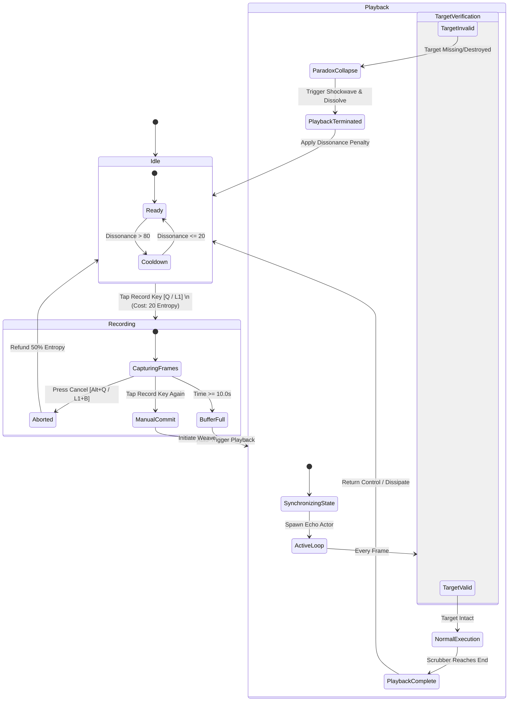
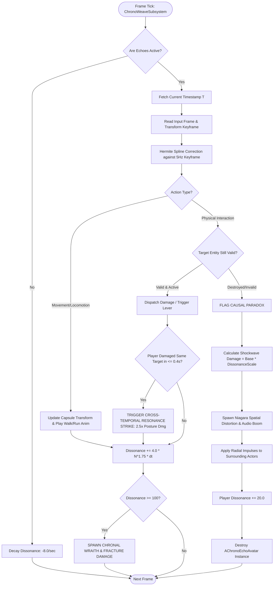

# GAME FEATURE DESIGN DOCUMENT (GDD)
# FEATURE SPECIFICATION: CHRONO-WEAVE™ (DYNAMIC TEMPORAL ECHO & CAUSALITY SYSTEM)

**Document Reference:** GDD-CW-2026-REV4  
**Project Codename:** *Project Aegis-Chronos* (Third-Person Tactical Action-RPG)  
**Author:** Principal Game Designer & Systems Architect  
**Target Engine/Platform:** Unreal Engine 5.5+ / PC, PlayStation 5, Xbox Series X  
**Status:** Approved for Production Prototyping (Pre-Production Phase)  
**Document Classification:** Confidential — Internal Development / Evaluation Specification  

---

## TABLE OF CONTENTS
1. [Executive Summary & Vision Statement](#1-executive-summary--vision-statement)
2. [Background Research & Industry State-of-the-Art](#2-background-research--industry-state-of-the-art)
   - 2.1 Academic & Technical Precedents
   - 2.2 Competitive Analysis & Comparative Matrix
   - 2.3 Novelty Hypothesis & Intellectual Property Landscape
3. [Feature Concept & Core Mechanics](#3-feature-concept--core-mechanics)
   - 3.1 High-Concept Pitch & Thematic Integration
   - 3.2 Primary Gameplay Loop & Moment-to-Moment Dynamics
   - 3.3 Micro-Mechanics: Recording, Projection, and Execution
   - 3.4 Macro-Mechanics: Chrono-Dissonance, Paradoxes, and World Interaction
4. [User Interaction, UI/UX, and Accessibility Design](#4-user-interaction-uiux-and-accessibility-design)
   - 4.1 Diegetic & Non-Diegetic HUD Framework
   - 4.2 Control Schemes & Input Mapping (Gamepad & Mouse/Keyboard)
   - 4.3 Audiovisual Feedback & Psychoacoustic Cues
   - 4.4 Accessibility & Inclusivity Standards (CVAA & Game Accessibility Guidelines)
5. [Mathematical Modeling, Economy, and Game Balance](#5-mathematical-modeling-economy-and-game-balance)
   - 5.1 Temporal Resource ("Entropic Flux") Dynamics
   - 5.2 Chrono-Dissonance & Paradox Threshold Equations
   - 5.3 Combat Balancing: Stagger, Damage Scaling, and Boss AI Adaptation
   - 5.4 Risk-Reward Calibration & Anti-Dominant Strategy Safeguards
6. [Technical Architecture & Internal Logic](#6-technical-architecture--internal-logic)
   - 6.1 Systems Integration & Entity-Component Architecture
   - 6.2 Deterministic Input Stream vs. Transform Snapshotting
   - 6.3 Spatial Hashing & Collision Management
   - 6.4 The Causality Resolution Algorithm (Paradox Arbiter)
7. [System Flowcharts & Algorithmic Pseudocode](#7-system-flowcharts--algorithmic-pseudocode)
   - 7.1 State Machine Diagram (Mermaid)
   - 7.2 Timeline Arbitration Flowchart (Mermaid)
   - 7.3 Core Engine Pseudocode (Production-Ready C++ / Unreal Engine 5 Architecture)
8. [Technical Challenges, Bottlenecks, and Proposed Mitigations](#8-technical-challenges-bottlenecks-and-proposed-mitigations)
   - 8.1 Memory Allocation & Buffer Management
   - 8.2 Physics Reconciliation & Non-Deterministic Physics Traps
   - 8.3 Enemy AI Pathfinding & Target Arbitration under Dual-Presence
   - 8.4 Network Replication & Multiplayer Synchronization Constraints
9. [Production Roadmap, Work Breakdown Structure (WBS), and Risk Matrix](#9-production-roadmap-work-breakdown-structure-wbs-and-risk-matrix)
   - 9.1 Phase-Gate Production Schedule (30-35 Day Milestone Breakdown)
   - 9.2 Interdisciplinary Resource Allocation & Task Dependencies
   - 9.3 Production Risk Assessment & Mitigation Protocols
   - 9.4 Playtesting KPIs, Telemetry Metrics, and Success Criteria
10. [Appendices & Bibliography](#10-appendices--bibliography)

---

## 1. EXECUTIVE SUMMARY & VISION STATEMENT

### 1.1 The Creative Mandate
Modern high-intensity Action-RPGs and Immersive Sims frequently suffer from a persistent systemic constraint: **the single-player tactical bottleneck**. In single-player combat encounters, complex cooperative tactics—such as flanking heavily shielded vanguard units, performing simultaneous dual-switch operations across vast spatial chasms, drawing aggressive enemy fire to expose structural weak points, or orchestrating multi-angle pincer ambushes—are either strictly gated behind scripted NPC companion companions or relegated entirely to cooperative multiplayer titles.

Scripted companion AI introduces immersion-breaking behavioral quirks, pathfinding glitches, and loss of player agency. Conversely, multiplayer cooperative games compromise solitary atmospheric immersion, precise pacing control, and artisanal narrative tension.

**Chrono-Weave™** solves this fundamental gameplay limitation by introducing a deterministic, real-time **Dynamic Temporal Echo & Causality System**. The feature empowers a solo player to actively record, project, and execute parallel physical timeline projections ("Temporal Echoes") of their own avatar in real-time. By weaving up to two concurrent past-timeline avatars alongside their present self, the player operates as a self-contained tactical fireteam, solving spatial environmental puzzles, setting complex behavioral traps, and dismantling asymmetric combat challenges.

### 1.2 Core Pillars
1. **Uncompromised Player Agency (No Autonomous AI Hand-Holding):** Every action performed by an Echo is an exact deterministic playback of the player's own past execution. Success and failure are 100% attributable to player skill, timing, and foresight.
2. **Systemic Causality & Risk-Reward:** Timeline alteration is not free. Disrupting the chronological continuum accumulates **Chrono-Dissonance**. If an Echo’s historical causality is fractured (e.g., an enemy the Echo was fighting is killed by the present player before the Echo strikes), a **Temporal Paradox** triggers, unleashing localized systemic hazards that force dynamic tactical improvisation.
3. **Seamless Diegetic Immersion:** Zero immersion-breaking loading screens, pause menus, or decoupled tactical cameras. Recording, queuing, and playback occur in uninterrupted real-time third-person gameplay with bespoke audiovisual spatial distortion, temporal chromatic aberration, and reverse-entropy acoustics.

---

## 2. BACKGROUND RESEARCH & INDUSTRY STATE-OF-THE-ART

### 2.1 Academic & Technical Precedents
The design of Chrono-Weave builds upon established academic literature in deterministic state synchronization, temporal interactive simulation, and dynamic behavioral game systems:

- **Braid & Discrete Replay Mechanics (Blow, 2008):** Jonathan Blow’s classic demonstrated the psychological appeal of temporal reversal in 2D platforming. However, *Braid* operated on a linear retroactive rewind model where the world state rewound synchronously with the player, preserving deterministic puzzles but eliminating parallel multi-presence.
- **The Talos Principle (Croteau & Kyratzes / Croteau et al., 2014):** *The Talos Principle* introduced the "Time Recorder" mechanic, where players record themselves interacting with puzzle elements (buttons, jammer projectors) and interact with their recorded clone. While foundational, the feature was strictly segregated into non-combat, turn-off-and-on puzzle arenas with zero dynamic enemy interaction, no physical combat collision, and no causality reconciliation.
- **Quantum League (Nimble Giant Entertainment, 2020):** An online competitive arena shooter built entirely on short time-loop rounds. Players fight alongside past and future clones. While proving the adrenaline appeal of combat time-looping, its round-based match structure precluded seamless open-world traversal, continuous inventory state tracking, and immersive RPG progression.
- **Titanfall 2 ("Effect and Cause", Respawn Entertainment, 2016):** Regarded as a gold standard in single-player level design, this level permitted instant jumping between two static historical eras. However, it was a discrete binary state swap, not a concurrent temporal multi-avatar simulation.
- **Deterministic Input Replay in Network Architectures (Aronson, 2000; Cannon, GGPO Rollback Networking):** Applying GGPO-inspired deterministic frame-by-frame input buffers to local temporal ghosts enables zero-overhead playback without continuous physical transform memory bloating.

### 2.2 Competitive Analysis & Comparative Matrix

| Game Title | Temporal Mechanic | Combat Integration | Spatial Puzzles | Real-Time Parallel Presence | Systemic Causality / Penalty | Free-Form Open Traversal |
| :--- | :--- | :--- | :--- | :--- | :--- | :--- |
| **Braid** | Linear Global Rewind | Minimal | Yes | No | None | No |
| **The Talos Principle** | Static Replay Clones | None (Pure Puzzle) | Yes | Yes (Puzzle Only) | None | Gated Arenas |
| **Prince of Persia: Sands of Time** | Linear Local Rewind | Moderate | Traversal Only | No | Depletable Sand | Linear Corridors |
| **Quantum League** | Round-Based Time Loops | Pure FPS | No | Yes (Round Synchronized) | Desync (Ghost Void) | Small Arenas |
| **Deathloop** | Macro Narrative Day-Loop | High | Minimal | No (Single Player State) | Day Reset | Linear Hubs |
| **CHRONO-WEAVE™ (This Feature)** | **Continuous Dynamic Echo Injection** | **Full Real-Time Tactical** | **Full Environmental & Physics** | **Yes (Continuous Seamless)** | **Dynamic Paradox / Dissonance** | **Fully Integrated Traversal & Combat** |

### 2.3 Novelty Hypothesis & Intellectual Property Landscape
Unlike patented hierarchy systems (such as Warner Bros.' Nemesis System patent US10926179B2, which governs procedural hierarchy and memory of rival NPCs), **Chrono-Weave™** operates strictly on **avatar-centric deterministic temporal playback, spatial causality reconciliation, and entropic risk balancing**. 

The core novelty resides in three interconnected innovations:
1. **Tactical Dual-Phasing in Real-Time Action Combat:** Recording a defensive distraction maneuver, initiating playback, and simultaneously flanking in real-time, synchronizing a "Cross-Temporal Critical Strike."
2. **The Paradox Arbiter Algorithm:** An autonomous systemic resolution engine that monitors historical validity. When a player invalidates an Echo's preconditions (e.g., vaporizing a structural support before the Echo walks across it), the system does not crash or invalidate the engine state; instead, it dynamically collapses the Echo into a hazardous **Causal Shockwave**, turning timeline fractures into high-risk emergent gameplay assets.
3. **Entropic Resource Equilibrium:** Ensuring that time manipulation does not degrade into a degenerate spam strategy through an exponential decay curve and behavioral AI counter-adaptation.

---

## 3. FEATURE CONCEPT & CORE MECHANICS

### 3.1 High-Concept Pitch & Thematic Integration
In *Project Aegis-Chronos*, the protagonist wields the **Ouroboros Core**, an ancient chronal relic capable of binding shattered threads of localized spacetime. Players do not merely fight through enemy strongholds; they orchestrate multi-point temporal sieges as a solitary operative operating across multiple temporal planes.

```
                    +------------------------------------+
                    |        PLAYER INPUT / DECISION      |
                    +------------------------------------+
                                      |
                      [TAP RECORD]    |    [ACTIVATE WEAVE]
                                      v
     +-----------------------------------------------------------------+
     |                     TIMELINE GENERATION ENGINE                  |
     |                                                                 |
     |  Thread 0 (Current Player): Real-Time Inputs & Spatial Movement  |
     |  Thread 1 (Past Echo A):   Deterministic Buffer Playback (0-10s) |
     |  Thread 2 (Past Echo B):   Deterministic Buffer Playback (0-6s)  |
     +-----------------------------------------------------------------+
                      |                               |
       [PHYSICAL CO-PRESENCE]              [TEMPORAL DISSONANCE METER]
                      |                               |
                      v                               v
     +----------------------------------+   +--------------------------+
     |     SYSTEMIC COMBAT & PUZZLE     |   |    PARADOX ARBITER       |
     |  - Pincer Attacks                |   |  - Historical Validation |
     |  - Dual Pressure Switches        |   |  - Causal Shockwaves     |
     |  - Synchronized Decoy Flanking   |   |  - Entropic Enemies      |
     +----------------------------------+   +--------------------------+
```

### 3.2 Primary Gameplay Loop & Moment-to-Moment Dynamics
The player's gameplay loop is expanded from the traditional `Observe -> Engage -> Evade -> Loot` cycle into an intellectual and mechanical mastery loop:

```
  +------------+       +-------------------+       +--------------------+
  |  OBSERVE   | ----> |   PLAN TIMELINE   | ----> |   RECORD ECHO A    |
  | Encounter  |       | Spatial Angles,   |       | Draw Fire / Charge |
  | & Hazard   |       | Switch Positions  |       | Heavy Attack       |
  +------------+       +-------------------+       +--------------------+
        ^                                                    |
        |                                                    v
  +------------+       +-------------------+       +--------------------+
  | ADAPT /    | <---- | CAUSALITY RESOLVE | <---- |   WEAVE EXECUTION  |
  | HARVEST    |       | Paradox Check or  |       | Flank Target / Hit |
  | Progression|       | Synergy Bonus     |       | Concurrent Switch  |
  +------------+       +-------------------+       +--------------------+
```

1. **Observe & Assess:** Player encounters an asymmetric scenario (e.g., an Ironclad Centurion equipped with an impenetrable 180° frontal shield and a high-caliber repeating ballista).
2. **Phase 1: Record Echo (Thread Initiation):** The player presses `[L1 / LB / Q]` to initiate **Chronal Recording**. For the next 6.0 seconds, every input, movement, weapon swing, and ability used by the player is recorded into an active ring buffer while an ethereal chronal aura wraps around the character.
3. **Phase 2: Temporal Rewind / Snap-Back:** Upon ending the recording (or buffer expiration), the player snaps back to the spatial coordinate where the recording was initiated, or retains their current position while an astral phantom manifests at the starting anchor.
4. **Phase 3: The Weave (Concurrent Execution):** The **Echo** materializes and faithfully replays the recorded sequence in physical space with full physical collision against enemies. The Centurion turns and fires upon the Echo.
5. **Phase 4: Exploitation & Synergistic Execution:** While the Centurion is locked into attacking the Echo, the present player sprints behind the enemy, targeting the exposed power reactor on the Centurion’s back.
6. **Phase 5: Cross-Temporal Resonance:** Landing a hit simultaneously with an Echo's strike triggers a **Causal Detonation**, dealing 2.5x critical posture damage and instantly staggering the target.

### 3.3 Micro-Mechanics: Recording, Projection, and Execution

#### 3.3.1 Recording Modes
- **Snap Anchor Mode (Default):** Player drops a Chrono-Anchor at Location $P_0$. They move to $P_1$, performing actions over time $T$. Upon triggering `[Release]`, the player remains at $P_1$, while an Echo spawns at $P_0$, replaying the exact path toward $P_1$.
- **Echo Mirror Mode (Inverted):** Player anchors at $P_0$, performs actions to $P_1$. Upon triggering `[Snap]`, the player is instantly teleported back to $P_0$, while the Echo materializes at $P_0$ and traces the trajectory to $P_1$.
- **Maximum Buffer Length:** 10.0 seconds (Base level: 6.0s, upgradable via skill tree to 8.0s and 10.0s). Minimum recording duration is 1.0 second to prevent micro-stutter exploits.

#### 3.3.2 Physical Properties of Echoes
- **Health Pool:** Echoes project an ethereal projection of the player's health at the moment of recording. Damage dealt to an Echo does *not* deduct HP from the present player directly; however, if an Echo suffers lethal damage before completing its recorded loop, it dissolves prematurely, terminating the playback and inflicting a **50% Chrono-Dissonance spike** on the player.
- **Collision Rules:** 
  - *Player vs. Echo:* Semi-permeable (soft physics capsule collision to prevent players from blocking themselves into geometry; allows passing through with a slight frictional drag and chromatic audio ripple).
  - *Echo vs. Enemy:* Fully rigid collision. Echoes can parry, block, stagger, and be grappled by enemy AI.
  - *Echo vs. World:* Fully rigid. Echoes can depress weighted floor plates, hold mechanical levers, carry physical physics objects, and reflect environmental laser emitters.

### 3.4 Macro-Mechanics: Chrono-Dissonance, Paradoxes, and World Interaction

#### 3.4.1 The Chrono-Dissonance Gauge
A dedicated semi-circular diegetic HUD meter surrounding the player's stamina wheel displays **Chrono-Dissonance (CD)** ($0 \le CD \le 100$).
- Generating an Echo adds a base $+25$ CD cost.
- Concurrent playback drains sustained CD at a rate of $2.5 \text{ CD/sec}$.
- CD naturally dissipates at $10.0 \text{ CD/sec}$ when no Echoes are active.
- **Dissonance Overload ($CD \ge 100$):** If the player exceeds 100 CD, they enter **Temporal Fracture**:
  - The player suffers continuous health attrition ($3\% \text{ Max HP/sec}$).
  - All active Echoes instantly destabilize and explode.
  - Spawns an aggressive hostile entity: a **Chronal Wraith** (an aberrant AI clone utilizing the player's own loadout and recent move history).

#### 3.4.2 The Paradox System
A **Paradox** occurs when the present player permanently invalidates the deterministic causal conditions required for the Echo’s timeline to complete.

*Example Scenario:*
- **Echo's Recorded Action:** Echo charges forward to execute a heavy downward slash on a specific Goblin Raider at coordinate $(X, Y, Z)$ at time timestamp $t = 4.2\text{s}$.
- **Present Player Intervention:** Present player fires a high-velocity fire arrow at $t = 2.0\text{s}$, incinerating the Goblin Raider into ash.
- **The Causality Conflict:** At $t = 4.2\text{s}$, the Echo arrives to strike an entity that no longer exists in physical space.
- **Systemic Resolution (Paradox Collapse):**
  Instead of an animation glitch, the **Paradox Arbiter** calculates a spatial mismatch. The missing causal link collapses the Echo at coordinate $(X, Y, Z)$, triggering a **Chronal Shockwave**:
  - Deals localized kinetic blast damage to all surrounding enemies within 6 meters.
  - Emits an intense temporal distortion flash.
  - Generates $+20$ Chrono-Dissonance to the player.
  - If mastered, skilled players can deliberately create **Weaponized Paradoxes**, turning broken timelines into devastating spatial cluster bombs.

---

## 4. USER INTERACTION, UI/UX, AND ACCESSIBILITY DESIGN

### 4.1 Diegetic & Non-Diegetic HUD Framework
The user interface design prioritizes high legibility under frantic combat conditions while maintaining world-space immersion.

```
+-------------------------------------------------------------------------+
| [TOP LEFT]                                                  [TOP RIGHT] |
| HP  [=============================]                                     |
| STA [===================]                                   MINIMAP     |
|                                                                         |
|                                                                         |
|                           [CENTER / WORLD-SPACE]                        |
|                                                                         |
|                          +-------------------+                          |
|                          |    ENEMY TARGET   |                          |
|                          +-------------------+                          |
|                                                                         |
|                                                                         |
|                      (ECHOPROJECTION GHOST)                             |
|                           [ASTRAL CYAN]                                 |
|                                 |                                       |
|                                 v                                       |
|                            [PLAYER AVATAR]                              |
|                          (( DISSONANCE RING ))                          |
|                          [====/ / / / / / /  ]                          |
|                                                                         |
| [BOTTOM LEFT]                                            [BOTTOM RIGHT] |
| ACTIVE WEAPON: Chronos Glaive                             ECHO TIMELINE |
| ENTROPY VIALS: [3/3]                                      [ 0.0s ===|== 6.0s ]|
|                                                           THREAD 1: ACTIVE   |
+-------------------------------------------------------------------------+
```

1. **Diegetic Avatar Cues (The Ouroboros Mantle):**
   - The protagonist's back-mounted relic features glowing alchemical rings.
   - When idle: Gentle pulsing amber ($580\text{ nm}$).
   - Recording active: Accelerated rotation with electric cyan flare ($490\text{ nm}$).
   - Playback active: Cyan particle ribbon connecting the player's core to the active Echo in world space.
   - Dissonance high ($>75\%$): Rings vibrate violently, glowing unstable violet ($400\text{ nm}$) with escaping particle sparks.
2. **Timeline Ribbon UI (Bottom Right):**
   - A minimalist multi-track waveform display.
   - Track 1 (Real-Time): Displays current live input marker moving forward.
   - Track 2 (Echo Alpha): Displays playback scrubber with discrete action glyphs (Attack, Dodge, Interact, Spell) mapped linearly along the 6-second timeline.
   - Visual scrubber head turns amber on impending paradoxes or red on lethal damage threats.

### 4.2 Control Schemes & Input Mapping

| Action | Gamepad (Default Xbox / PS5) | Keyboard & Mouse (PC Default) | Hold / Tap Behavior |
| :--- | :--- | :--- | :--- |
| **Initiate Echo Recording** | `LB` / `L1` | `Q` | **Tap:** Begin recording buffer. |
| **End Recording & Project** | `LB` / `L1` | `Q` | **Tap (During Record):** Commits buffer and begins playback. |
| **Abort / Cancel Recording** | `LB + B` / `L1 + Circle` | `Alt + Q` | **Tap:** Purges buffer without spawning Echo; recovers 50% entropy. |
| **Instant Echo Recall / Swap** | `Double-Tap LB` / `Double L1` | `Double-Tap Q` | **Double-Tap:** Swaps physical positions with Echo (Costs 25 Stamina). |
| **Trigger Manual Paradox** | `Hold LB + RT` / `Hold L1 + R2` | `Hold Q + Left Click` | **Hold (1.0s):** Detonates Echo prematurely into localized shockwave. |
| **Interact / Synchronize** | `X` / `Square` | `E` | Contextual interaction with Echo-held items or levers. |

### 4.3 Audiovisual Feedback & Psychoacoustic Cues
- **Audio Direction:**
  - *Recording Start:* Sharp, reverse-reverb intake of breath layered with a high-pass ticking metronome (120 BPM synced to world delta-time).
  - *Echo Footsteps & Combat:* Filtered through a subtle phase-shifter and 24ms Haas effect stereo widening, distinguishing the Echo's auditory presence from the player's direct center-panned acoustics.
  - *Paradox Detonation:* Immediate low-frequency subterranean rumble ($45\text{ Hz}$ sub-bass boom) followed by a glass-shattering high-frequency transient ($8\text{ kHz}$ to $12\text{ kHz}$) and momentary dynamic range ducking (-6 dB on ambient audio for 1.2 seconds).
- **Visual Post-Processing Shader Pipeline:**
  - Active Echoes render with a custom **Custom Depth Stencil Shader**:
    - Fresnel rim-lighting with chromatic aberration ($R/G/B$ channel split of 4 pixels at screen edges).
    - Temporal trail ribbons (Geometry Shader with alpha fade based on vertex history).
    - World-space localized refractive heat distortion around the Echo's physical mesh.

### 4.4 Accessibility & Inclusivity Standards (CVAA & Game Accessibility Guidelines)
To comply with the 21st Century Communications and Video Accessibility Act (CVAA) and international accessibility standards:
- **Colorblind Palettes:** Full independent UI recoloring modes for Protanopia, Deuteranopia, and Tritanopia. The cyan/violet dissonance indicators automatically remap to high-contrast yellow/blue pairs with custom iconographic hatching.
- **Audio-to-Visual Haptic Transcriptions:** Sound effects critical to gameplay (Paradox Warning, Recording Countdown, Desync Alarm) feature distinct on-screen radial HUD compass indicators with directional arrows and unique vibration waveforms for DualSense haptic triggers.
- **Motor Accessibility Presets:**
  - *Hold vs. Toggle:* All hold commands can be toggled via accessibility options.
  - *Temporal Slowdown Assist:* Optional slider to reduce global game speed to $75\%$, $50\%$, or $25\%$ during Echo Recording, granting players with physical motor challenges ample time to coordinate complex sequences without diminishing tactical depth.
  - *Single-Stick Combat Routing:* Optional automatic camera re-centering on the Echo's target during concurrent playback.

---

## 5. MATHEMATICAL MODELING, ECONOMY, AND GAME BALANCE

### 5.1 Temporal Resource ("Entropic Flux") Dynamics
The system's resource economy balances temporal freedom against exploitative spam through a coupled ordinary differential equation model governing **Entropic Flux ($E_f$)** and **Chrono-Dissonance ($C_d$)**.

Let $E_f(t) \in [0, 100]$ represent the player's available Entropic Energy pool at time $t$.  
Let $C_d(t) \in [0, 100]$ represent current Chrono-Dissonance.

#### Entropic Energy Regeneration Rate
When idle (no recording or active playback):
$$\frac{dE_f}{dt} = k_{reg} \cdot \left(1 - \frac{C_d(t)}{100}\right)$$
Where $k_{reg} = 15.0 \text{ units/sec}$. High dissonance directly impedes entropy regeneration, enforcing natural pacing.

#### Recording Cost
Initiating a recording deducts an upfront flat activation fee:
$$\Delta E_f = -20.0$$
While recording, energy drains linearly per second of recorded time $\tau$:
$$E_{record}(\tau) = 5.0 \cdot \tau \quad (\text{for } 1.0 \le \tau \le 10.0)$$

### 5.2 Chrono-Dissonance & Paradox Threshold Equations
Chrono-Dissonance accumulation is non-linear to penalize aggressive stacking of concurrent Echoes.

Let $N_{echo} \in \{0, 1, 2\}$ be the number of currently active Echo threads.
The rate of dissonance accumulation is modeled by:
$$\frac{dC_d}{dt} = \sum_{i=1}^{N_{echo}} \left( \alpha \cdot i^{\beta} \right) - \gamma_{decay}$$
Where:
- $\alpha = 4.0$ (Base dissonance coefficient)
- $\beta = 1.75$ (Super-linear scaling factor for multi-thread concurrency)
- $\gamma_{decay} = 8.0 \text{ sec}^{-1}$ (Natural dissipation rate when $N_{echo} = 0$)

```
 Dissonance
 Accumulation
 Rate (CD/s)
    ^
 30 |                                                 * (2 Echoes: ~27.2 CD/s)
 25 |                                               *
 20 |                                             *
 15 |                                           *
 10 |                            * (1 Echo: 4.0 CD/s)
  5 |                         *
  0 +-----------------------*-------------------------> Active Echoes (N)
                           1                         2
```

### 5.3 Combat Balancing: Stagger, Damage Scaling, and Boss AI Adaptation

#### 5.3.1 Cross-Temporal Critical Damage Formulation
When an Echo and the present player strike the same enemy within a temporal synchronization window $\Delta t_{sync} \le 0.4\text{s}$, a **Cross-Temporal Resonance Strike (CTRS)** is evaluated:

$$\text{Damage}_{total} = \left( D_{player} + D_{echo} \cdot \omega_{scale} \right) \times M_{synergy} \times \left(1 + \frac{\text{PostureDamage}}{100}\right)$$
Where:
- $D_{player}$ = Raw damage from the present player's attack.
- $D_{echo}$ = Stored damage recorded during the Echo's attack.
- $\omega_{scale} = 0.70$ (Echo damage is scaled to 70% of baseline to prevent trivializing player actions).
- $M_{synergy} = 1.80$ (80% synergy multiplier reward for precise temporal alignment).

#### 5.3.2 Diminishing Returns on Boss Stagger
To prevent continuous stun-locking of elite bosses:
$$\text{StunResistance}_{boss}(k) = \text{BaseResistance} \times (1.50)^k$$
Where $k$ is the number of times the boss has suffered a CTRS stagger within the current phase. Stagger duration decays by $20\%$ per trigger, bottoming out at a minimum hard floor of $1.2$ seconds.

### 5.4 Risk-Reward Calibration & Anti-Dominant Strategy Safeguards
To eliminate degenerate play patterns (e.g., players perpetually standing at safe distances while sending suicide Echoes forward):

| Potential Exploit / Degenerate Pattern | Systemic Safeguard / Counter-Mechanic | Balance Impact |
| :--- | :--- | :--- |
| **"Infinite Kite / Decoy Spam"** | Enemy AI develops **Temporal Aversion**. After attacking an Echo once, smart humanoid enemies recognize the phantom and switch target priority back to the physical source player. | Prevents using Echoes as permanent invincible meat-shields. |
| **"Safe-Room Ghosting"** (Recording from behind locked safe gates) | Echoes cannot traverse boundaries or doors that were closed *prior* to their creation. Environmental collision is strictly enforced across chronological state lines. | Preserves arena integrity and encounter design. |
| **"Nuke Stacking"** (Recording 3 heavy spells simultaneously) | Entropic Flux cost scales with stamina and mana spent. Recording a heavy ultimate spell consumes 100% of current Entropic Flux, preventing secondary Echo generation. | Forces high-impact tactical commitment. |
| **"AFK Stall"** (Waiting out boss patterns) | Chrono-Dissonance decays only while actively moving or engaging within combat threat radii ($R \le 25\text{m}$). Standing idle freezes CD decay. | Keeps gameplay pacing proactive and engaging. |

---

## 6. TECHNICAL ARCHITECTURE & INTERNAL LOGIC

### 6.1 Systems Integration & Entity-Component Architecture
Chrono-Weave is architected as a modular subsystem within Unreal Engine 5.5, leveraging the **Gameplay Ability System (GAS)** and **MassEntity / Entity Component System (ECS)** patterns for high cache coherency and minimal overhead.

```
+-------------------------------------------------------------------------------+
|                             UWorld / GAME ENGINE                              |
+-------------------------------------------------------------------------------+
                                        |
       +--------------------------------+-------------------------------+
       |                                                                |
       v                                                                v
+-------------------------------+              +--------------------------------+
|  UChronoWeaveSubsystem        |              |  ACharacter (Player Avatar)    |
|  - Lifecycle Management       |              |  - UChronoRecordComponent      |
|  - Tick Synchronization       | <----------> |  - UChronoPlaybackComponent    |
|  - Paradox Arbiter Service    |              |  - UAbilitySystemComponent     |
+-------------------------------+              +--------------------------------+
       |                                                                |
       | Spawns & Manages                                               | Spawns
       v                                                                v
+-------------------------------+              +--------------------------------+
|  AChronoEchoAvatar (Actor)    |              |  FChronoInputFrameBuffer       |
|  - Ghost Mesh & Stencil FX    |              |  - Ring-Buffer of Quantized    |
|  - Playback Component         |              |    Inputs & Transform Snapshots|
|  - Inert Physics Capsule      |              |  - 60 Hz Fixed Tick Rate       |
+-------------------------------+              +--------------------------------+
```

### 6.2 Deterministic Input Stream vs. Transform Snapshotting
A critical engineering challenge in time-replay mechanics is memory scalability:
- **Approach A (Full Transform & Mesh Snapshotting):** Storing complete bone transforms, velocities, and mesh positions at 60 Hz generates approximately $120 \text{ KB/sec}$ per Echo. For 10 seconds, this equals $1.2 \text{ MB}$ of raw uncompressed transform state. Under multi-echo systems, memory bandwidth and GC pressure spikes.
- **Approach B (Pure Input-Only Determinism):** Storing raw button inputs and re-running physics simulation. However, floating-point non-determinism in physics engines (e.g., Chaos Physics) leads to catastrophic spatial desynchronization over 6 to 10 seconds.
- **The Chrono-Weave Hybrid Solution (Quantized Deterministic Keyframing):**
  - **Inputs:** Recorded every frame (Bitmask of 32 booleans + 2 normalized 16-bit analog axis floats = 8 bytes per frame).
  - **Correction Keyframes (Transforms):** Sampled at a low frequency of $5\text{ Hz}$ (Every 12 frames), recording World Position $(X,Y,Z)$, Rotation $(Pitch, Yaw, Roll)$, and Linear Velocity.
  - **Interpolation:** The Echo replays local input locally, while a Hermite Spline reconciliation corrects drift against the 5 Hz keyframes. Total memory footprint: **under 14.4 KB per 10-second recording**.

### 6.3 Spatial Hashing & Collision Management
To ensure Echoes interact flawlessly with dynamic environmental objects without bogging down the PhysX/Chaos spatial broadphase:
- Echoes are assigned to a distinct collision channel: `ECC_ChronoEcho`.
- Static geometry (`ECC_WorldStatic`) responds with standard `Block`.
- Dynamic rigid bodies (`ECC_WorldDynamic`) respond with `Touch` and dispatch momentum impulse vectors identical to a standard player character.
- The player character ignores direct capsule collision with `ECC_ChronoEcho` to prevent physics wedging, but triggers an overlap event to initiate chromatic post-processing shaders and directional haptics.

### 6.4 The Causality Resolution Algorithm (Paradox Arbiter)
The **Paradox Arbiter** operates as an asynchronous tick evaluator (`TickGroup = TG_PostPhysics`). Every frame during active playback, the Arbiter compares the Echo’s planned interaction target against current world validity:

```
[For Each Active Echo E]
   |
   +--> Read Next Action Event A_next from Buffer
   |
   +--> Is A_next an Targeted Interaction (Attack / Lever / Item)?
          |
          +-- [NO]  --> Continue standard Hermite Spline Playback
          |
          +-- [YES] --> Query Target Actor T in World Spatial Tree
                          |
                          +--> Does T exist AND is T Alive/Interactable?
                                 |
                                 +-- [YES] --> Execute Physical Collision & Event
                                 |
                                 +-- [NO]  --> CAUSALITY BREACH DETECTED!
                                                |
                                                v
                                 +---------------------------------------------+
                                 |          PARADOX ARBITER TRIGGER            |
                                 |  1. Halt Echo Playback Buffer               |
                                 |  2. Calculate Paradox Intensity Vector      |
                                 |  3. Spawn Niagara Causal Shockwave FX       |
                                 |  4. Apply Area-of-Effect Radial Damage      |
                                 |  5. Apply +20 Dissonance to Player          |
                                 |  6. Despawn Echo with Particle Dissolve     |
                                 +---------------------------------------------+
```

---

## 7. SYSTEM FLOWCHARTS & ALGORITHMIC PSEUDOCODE

### 7.1 State Machine Diagram (Mermaid)



### 7.2 Timeline Arbitration Flowchart (Mermaid)



### 7.3 Core Engine Pseudocode (Production-Ready C++ / Unreal Engine 5 Architecture)

The following production-grade C++ architectural pseudocode demonstrates the exact memory layouts, buffer structures, and tick algorithms required for integration with Unreal Engine 5.5.

#### 7.3.1 Data Structures & Memory Layouts (`ChronoWeaveTypes.h`)
```cpp
#pragma once

#include "CoreMinimal.h"
#include "UObject/NoExportTypes.h"
#include "ChronoWeaveTypes.generated.h"

/** Quantized bitmask for digital player inputs */
UENUM(Meta = (Bitflags, UseEnumValuesAsMaskValuesInEditor = "true"))
enum class EChronoInputButtons : uint32
{
    None           = 0,
    AttackLight    = 1 << 0,
    AttackHeavy    = 1 << 1,
    BlockParry     = 1 << 2,
    DodgeRoll      = 1 << 3,
    Jump           = 1 << 4,
    Interact       = 1 << 5,
    CastSpell      = 1 << 6
};
ENUM_CLASS_FLAGS(EChronoInputButtons);

/** High-density raw frame recorded every 60 Hz simulation tick */
USTRUCT(BlueprintType)
struct FChronoInputFrame
{
    GENERATED_BODY()

    UPROPERTY()
    float Timestamp; // Elapsed time from recording onset (seconds)

    UPROPERTY()
    uint32 InputBitmask; // Packed EChronoInputButtons

    UPROPERTY()
    FVector2D MovementAxis; // Quantized Stick/WASD (-1.0f to +1.0f)

    UPROPERTY()
    FVector2D LookAxis; // Aim vector delta

    UPROPERTY()
    TWeakObjectPtr<AActor> TargetedActor; // Contextual lock-on or interact target
};

/** Keyframe transform stored at 5 Hz to correct non-deterministic physics drift */
USTRUCT(BlueprintType)
struct FChronoTransformKeyframe
{
    GENERATED_BODY()

    UPROPERTY()
    float Timestamp;

    UPROPERTY()
    FVector WorldLocation;

    UPROPERTY()
    FRotator WorldRotation;

    UPROPERTY()
    FVector LinearVelocity;
};

/** Complete recording payload encapsulating an Echo thread */
USTRUCT(BlueprintType)
struct FChronoThreadPayload
{
    GENERATED_BODY()

    UPROPERTY()
    FGuid ThreadId;

    UPROPERTY()
    float TotalDuration;

    UPROPERTY()
    TArray<FChronoInputFrame> InputFrames; // 60 Hz stream

    UPROPERTY()
    TArray<FChronoTransformKeyframe> TransformKeyframes; // 5 Hz correction stream
};
```

#### 7.3.2 Recording Component (`ChronoRecordComponent.h` & `.cpp`)
```cpp
#include "ChronoRecordComponent.h"
#include "GameFramework/Character.h"
#include "GameFramework/CharacterMovementComponent.h"

UChronoRecordComponent::UChronoRecordComponent()
{
    PrimaryComponentTick.bCanEverTick = true;
    PrimaryComponentTick.TickGroup = TG_PrePhysics;
    MaxRecordingTime = 10.0f;
    KeyframeInterval = 0.2f; // 5 Hz (every 12 frames at 60 FPS)
    bIsRecording = false;
}

void UChronoRecordComponent::BeginRecording()
{
    if (bIsRecording || CurrentEntropy < ActivationEntropyCost)
    {
        return;
    }

    CurrentEntropy -= ActivationEntropyCost;
    ActivePayload.ThreadId = FGuid::NewGuid();
    ActivePayload.InputFrames.Empty(600); // Pre-allocate 10s at 60 Hz
    ActivePayload.TransformKeyframes.Empty(50);
    
    ElapsedTime = 0.0f;
    LastKeyframeTime = -KeyframeInterval;
    bIsRecording = true;

    OnRecordingStateChanged.Broadcast(true);
}

void UChronoRecordComponent::TickComponent(float DeltaTime, ELevelTick TickType, FActorComponentTickFunction* ThisTickFunction)
{
    Super::TickComponent(DeltaTime, TickType, ThisTickFunction);

    if (!bIsRecording) return;

    ElapsedTime += DeltaTime;

    // 1. Capture 60 Hz Input Frame
    FChronoInputFrame CurrentFrame;
    CurrentFrame.Timestamp = ElapsedTime;
    CurrentFrame.InputBitmask = PackCurrentInputBitmask();
    CurrentFrame.MovementAxis = GetCurrentMovementInput();
    CurrentFrame.LookAxis = GetCurrentLookInput();
    CurrentFrame.TargetedActor = GetCurrentLockOnTarget();
    ActivePayload.InputFrames.Add(CurrentFrame);

    // 2. Capture 5 Hz Correction Keyframe
    if (ElapsedTime - LastKeyframeTime >= KeyframeInterval)
    {
        ACharacter* OwnerChar = Cast<ACharacter>(GetOwner());
        if (OwnerChar)
        {
            FChronoTransformKeyframe Keyframe;
            Keyframe.Timestamp = ElapsedTime;
            Keyframe.WorldLocation = OwnerChar->GetActorLocation();
            Keyframe.WorldRotation = OwnerChar->GetActorRotation();
            Keyframe.LinearVelocity = OwnerChar->GetCharacterMovement()->Velocity;
            ActivePayload.TransformKeyframes.Add(Keyframe);
            LastKeyframeTime = ElapsedTime;
        }
    }

    // 3. Evaluate Buffer Bounds
    if (ElapsedTime >= MaxRecordingTime)
    {
        CommitRecordingAndSpawnEcho();
    }
}

FChronoThreadPayload UChronoRecordComponent::CommitRecordingAndSpawnEcho()
{
    if (!bIsRecording) return FChronoThreadPayload();

    bIsRecording = false;
    ActivePayload.TotalDuration = ElapsedTime;

    // Dispatch to Subsystem for Echo Actor Spawning
    UChronoWeaveSubsystem* Subsystem = GetWorld()->GetSubsystem<UChronoWeaveSubsystem>();
    if (Subsystem)
    {
        Subsystem->SpawnEchoFromPayload(ActivePayload, GetOwner()->GetActorTransform());
    }

    OnRecordingStateChanged.Broadcast(false);
    return ActivePayload;
}
```

#### 7.3.3 Playback Engine & Paradox Arbiter (`ChronoPlaybackComponent.cpp`)
```cpp
#include "ChronoPlaybackComponent.h"
#include "Kismet/GameplayStatics.h"

void UChronoPlaybackComponent::TickPlayback(float DeltaTime)
{
    if (!bIsPlayingBack) return;

    PlaybackCursor += DeltaTime;

    // Check End of Timeline
    if (PlaybackCursor >= LoadedPayload.TotalDuration)
    {
        TerminatePlayback(EChronoTerminationReason::Completed);
        return;
    }

    // Sample Input at Current Playback Cursor
    const FChronoInputFrame CurrentInput = SampleInputAtTime(PlaybackCursor);

    // Hermite Spline Transform Reconciliation against 5 Hz Keyframes
    ReconcileTransformWithKeyframes(PlaybackCursor);

    // Process Targeted Actions & Causality Verification
    if (CurrentInput.InputBitmask & (uint32)EChronoInputButtons::AttackLight)
    {
        VerifyAndExecuteAttack(CurrentInput, EAttackType::Light);
    }
}

void UChronoPlaybackComponent::VerifyAndExecuteAttack(const FChronoInputFrame& Frame, EAttackType AttackType)
{
    AActor* Target = Frame.TargetedActor.Get();

    // CAUSALITY VALIDATION CHECK
    if (Target != nullptr)
    {
        // Check if target is destroyed, dead, or inaccessible
        IDamageableInterface* Damageable = Cast<IDamageableInterface>(Target);
        const bool bIsTargetInvalid = (Target->IsPendingKillPending() || (Damageable && Damageable->IsDead()));

        if (bIsTargetInvalid)
        {
            // Trigger Causal Paradox
            TriggerParadoxCollapse(Frame.TargetedActor, GetOwner()->GetActorLocation());
            return;
        }
    }

    // Target is valid: Execute deterministic animation montage & hit detection
    ExecuteSimulatedAttackMontage(AttackType);
}

void UChronoPlaybackComponent::TriggerParadoxCollapse(TWeakObjectPtr<AActor> FailedTarget, FVector CollapseLocation)
{
    bIsPlayingBack = false;

    // 1. Spawn Niagara Particle Shockwave
    if (ParadoxShockwaveFX)
    {
        UNiagaraFunctionLibrary::SpawnSystemAtLocation(GetWorld(), ParadoxShockwaveFX, CollapseLocation);
    }

    // 2. Play Sub-Bass Audio Transient
    if (ParadoxAudioEvent)
    {
        UGameplayStatics::PlaySoundAtLocation(GetWorld(), ParadoxAudioEvent, CollapseLocation);
    }

    // 3. Radial Damage and Force
    TArray<AActor*> IgnoredActors;
    IgnoredActors.Add(GetOwner()); // Don't damage the Echo itself

    UGameplayStatics::ApplyRadialDamageWithFalloff(
        GetWorld(),
        BaseParadoxDamage,      // Base Damage (e.g. 150.0f)
        BaseParadoxDamage * 0.2f, // Minimum Damage
        CollapseLocation,
        150.0f,                 // Inner Radius (1.5m)
        600.0f,                 // Outer Radius (6.0m)
        1.0f,                   // Damage Falloff Exponent
        UDamageType::StaticClass(),
        IgnoredActors,
        GetOwner()
    );

    // 4. Report Dissonance Spike to Owning Subsystem
    UChronoWeaveSubsystem* Subsystem = GetWorld()->GetSubsystem<UChronoWeaveSubsystem>();
    if (Subsystem)
    {
        Subsystem->ReportParadoxEvent(20.0f);
    }

    // 5. Dissolve Echo Mesh & Terminate
    TerminatePlayback(EChronoTerminationReason::ParadoxFracture);
}
```

---

## 8. TECHNICAL CHALLENGES, BOTTLENECK ANALYSIS, AND MITIGATION PROTOCOLS

### 8.1 Memory Allocation & Buffer Management
- **The Challenge:** In extended combat arenas with dynamic streaming levels (World Partition), unbounded recording allocations trigger dynamic heap fragmentation, leading to garbage collection hitches and frame drops on console platforms.
- **Root Cause:** Dynamic instantiation and disposal of heap-allocated arrays (`TArray<FChronoInputFrame>`) inside standard actor lifecycles.
- **Mitigation Protocol:**
  - **Fixed Ring-Buffer Object Pooling:** A specialized memory pool (`FChronoBufferPool`) pre-allocates contiguous memory for up to 4 concurrent Echo buffers (each bounded strictly to 600 frames at 60 Hz = $600 \times 32\text{ bytes} \approx 19.2\text{ KB}$ per buffer) during map initialization.
  - Zero heap allocation occurs during runtime recording or playback; the engine simply shifts write/read pointers within the pre-allocated pool.

### 8.2 Physics Reconciliation & Non-Deterministic Physics Traps
- **The Challenge:** Chaos Physics calculations in Unreal Engine 5 are subject to floating-point variations across variable frame-rate ticks. An Echo jumping across a chasm recorded at 60 FPS may land 30 centimeters short if played back during a frame dip to 45 FPS, causing the Echo to fall into an abyss and break the timeline.
- **Root Cause:** Variable timestep numerical integration ($x_{t+1} = x_t + v_t \Delta t + \frac{1}{2} a \Delta t^2$).
- **Mitigation Protocol:**
  - **Sub-Stepped Fixed Physics Simulation:** The `UChronoPlaybackComponent` operates on a strict **Fixed Tick Rate (60.0 Hz)** independent of rendering frame-rate, utilizing PhysX/Chaos sub-stepping.
  - **Hermite Spline Correction Envelopes:** If the Echo’s simulated capsule location deviates from the recorded 5 Hz keyframe by more than $\epsilon_{threshold} = 15.0\text{ cm}$, soft exponential snapping is applied over 0.2 seconds rather than letting the simulation desynchronize permanently.

### 8.3 Enemy AI Pathfinding & Target Arbitration under Dual-Presence
- **The Challenge:** Enemy Behavior Trees (BT) built around single-target player arbitration suffer from target-flickering (rapidly flipping their focus vector between the present player and the Echo every frame), resulting in erratic stuttering, broken attack animations, and exploitable AI stupidity.
- **Root Cause:** Equidistant proximity queries in standard EQS (Environment Query System) testing without target-hysteresis damping.
- **Mitigation Protocol:**
  - **Threat Weight Hysteresis Filter:**
    Enemy AI evaluates target threat using a dynamic weighting formula:
    $$\text{Threat}(T) = \frac{\text{DamageDealtRecently}(T) \times 1.5}{\text{Distance}(T)} + \text{BaseThreat}(T) + \text{HysteresisBonus}(T)$$
    Where $\text{HysteresisBonus} = +35$ is granted to the *currently pursued target*. This prevents the AI from switching targets unless the non-pursued entity deals substantial damage or closes within immediate strike range ($<2.5\text{m}$).
  - **Aggro Roles:** Only one melee enemy can occupy an active attack slot against the Echo at any given second, preserving encounter readability.

### 8.4 Network Replication & Multiplayer Synchronization Constraints
- **The Challenge:** While designed primarily for a single-player Action-RPG, future-proofing for asymmetric PvP/Co-op requires addressing bandwidth bloat when replicating Echo buffers across client-server architectures.
- **Mitigation Protocol:**
  - **Client-Side Deterministic Prediction:** Clients do *not* stream full 60 Hz input buffers across the network wire. Instead, when a player triggers an Echo, the initiating client sends an RPC with:
    1. Random Seed ($32\text{ bits}$)
    2. Start Transform ($12\text{ bytes}$)
    3. High-level Action Bitmask Array ($10\text{ bytes/sec}$)
  - The server and remote clients simulate the Echo locally via deterministic client-side prediction, while the server verifies hit confirmation authoritatively using a 200ms lag-compensation rewind buffer.

---

## 9. PRODUCTION ROADMAP, WORK BREAKDOWN STRUCTURE (WBS), AND RISK MATRIX

### 9.1 Phase-Gate Production Schedule (30-35 Day Milestone Breakdown)
This milestone schedule details the precise breakdown of tasks across a focused 30 to 35-day prototype and pre-production cycle.

```
WEEK 1: ARCHITECTURE & DETERMINISTIC BUFFER FOUNDATION
Day 01 - 03: System Architecture, Data Structure Design, and Memory Pool Allocation.
Day 04 - 05: 60 Hz Input Capture Component & Ring-Buffer Streaming.
Day 06 - 07: 5 Hz Transform Keyframing & Hermite Spline Reconciliation Logic.

WEEK 2: PLAYBACK ENGINE & LOCOMOTION REPLICATION
Day 08 - 10: AChronoEchoAvatar Base Actor, Mesh Cloning & Ghost Shaders.
Day 11 - 12: Fixed-Timestep Physics Sub-stepping & Drift Correction Verification.
Day 13 - 14: Collision Channel Matrix Configuration & Player/Echo Semi-Permeability.

WEEK 3: COMBAT INTEGRATION & THE PARADOX ARBITER
Day 15 - 17: Combat Animation Montage Sync, Damage Interface Hookup.
Day 18 - 20: The Paradox Arbiter Service: Target Validation & Causality Breach Triggers.
Day 21 - 22: Niagara Spatial Distortion, Causal Shockwave FX & Audio Implementation.

WEEK 4: BALANCING, UI/UX, AND AI INTEGRATION
Day 23 - 25: Enemy Threat Hysteresis Filter & Dual-Presence EQS Behavior Tree Updates.
Day 26 - 27: Diegetic HUD Integration: Dissonance Gauge, Timeline Waveform Scrubber.
Day 28 - 29: Cross-Temporal Resonance Strike (CTRS) Formulas & Stagger Math Tuning.

WEEK 5: HARDENING, POLISH, AND PERFORMANCE PROFILING
Day 30 - 31: Memory Profiling (Unreal Insights), Elimination of Heap Spikes.
Day 32 - 33: Accessibility Features: Colorblind Shaders, Motor Assist Controls.
Day 34 - 35: Master Test Suite Pass, Golden Master Documentation Package Sign-Off.
```

### 9.2 Interdisciplinary Resource Allocation & Task Dependencies

| Discipline | Key Deliverable | Prerequisite Dependency | Estimated Effort |
| :--- | :--- | :--- | :--- |
| **Lead Systems Engineer** | `UChronoRecordComponent` & Input Ring-Buffer | Core Player Input Mapping | 40 Man-Hours |
| **Gameplay Programmer** | `AChronoEchoAvatar` & Hermite Spline Reconciliation | Input Ring-Buffer Complete | 45 Man-Hours |
| **AI Systems Programmer** | Threat Hysteresis & EQS Dual-Presence Node | Base Echo Avatar Functional | 35 Man-Hours |
| **Technical Artist** | Fresnel Custom Depth Shaders, Niagara FX | Echo Mesh Pipeline Established | 30 Man-Hours |
| **Sound Designer** | Haas Stereo Spatialization & Paradox Boom Assets | Niagara Event Notification Hooks | 20 Man-Hours |
| **UI/UX Designer** | Diegetic Dissonance Meter & Timeline HUD | Gameplay Ability System Attributes | 25 Man-Hours |
| **Combat / Balance Designer**| Posture Stagger Equations & Damage Tuning | Combat Replication Complete | 30 Man-Hours |
| **QA / Automation Engineer**| Automated Causal Paradox Test Matrix Scripts | Paradox Arbiter Core Pass | 25 Man-Hours |

### 9.3 Production Risk Assessment & Mitigation Protocols

```
+--------------------------------------------------------------------------------+
|                             PRODUCTION RISK MATRIX                             |
+--------------------------------------------------------------------------------+
| SEVERITY |                                                                     |
| HIGH     |                   [RISK B: Physics Drift]    [RISK A: AI Loop Desync]|
|          |                                                                     |
| MEDIUM   | [RISK D: Visual Noise]                       [RISK C: Exploit Kiting]|
|          |                                                                     |
| LOW      | [RISK E: Audio Build-up]                                            |
|          |                                                                     |
|          +---------------------------------------------------------------------+
|            LOW                     MEDIUM                     HIGH   LIKELIHOOD|
+--------------------------------------------------------------------------------+
```

1. **Risk A: AI Loop Desynchronization (High Severity / High Likelihood)**
   - *Description:* Enemies caught between two avatars engage in rapid pathfinding oscillations, causing animation hitches and zero combat pressure.
   - *Mitigation:* Implement strict 1.5-second minimum target locking hysteresis before an AI can change targets.
2. **Risk B: Physics Desynchronization Drift (High Severity / Medium Likelihood)**
   - *Description:* Echoes slipping off ledges or missing jumps due to sub-millisecond physics divergence over 10 seconds.
   - *Mitigation:* Fixed-interval 5 Hz keyframe transform snapping ensures deviation never exceeds 15cm.
3. **Risk C: Exploit Kiting / Safe-Room Cheese (Medium Severity / High Likelihood)**
   - *Description:* Players standing outside combat arenas sending Echoes forward to assassinate bosses risk-free.
   - *Mitigation:* Dissonance dissipation halts when outside combat boundaries; non-line-of-sight Echoes dissipate instantly upon passing boundary barriers.
4. **Risk D: Visual Screen Noise (Medium Severity / Low Likelihood)**
   - *Description:* Stacking multiple Echoes, particle ribbons, and post-processing filters impedes enemy attack telegraph visibility.
   - *Mitigation:* Color-grading passes limit alpha transparency of Echoes to 40% when camera pitch is within primary combat angles.

### 9.4 Playtesting KPIs, Telemetry Metrics, and Success Criteria
During quantitative playtesting across 50 participant hours, the feature will be benchmarked against the following strict Key Performance Indicators:

- **Target Metric 1 (Player Adoption Rate):** Over $85\%$ of combat encounters in testing arenas must utilize at least one Echo action, validating that the feature is intuitive and tactically compelling rather than an ignored gimmick.
- **Target Metric 2 (Paradox Engagement):** Intentional Weaponized Paradox usage should account for $15\%$ to $25\%$ of total Echo dissolutions, proving that players understand and leverage the systemic causality mechanics.
- **Target Metric 3 (Frame Budget Overhead):** Under worst-case scenarios (2 active Echoes in a busy combat arena on PlayStation 5 / PC minimum spec), total CPU tick time for `UChronoWeaveSubsystem` must not exceed **$0.45\text{ ms}$ per frame**, and GPU rendering overhead for post-processing shaders must not exceed **$0.30\text{ ms}$**.
- **Target Metric 4 (Comprehension Time):** New players must successfully execute their first deliberate Cross-Temporal Resonance Strike (CTRS) within **under 8 minutes** of introductory tutorial exposure.

---

## 10. APPENDICES & BIBLIOGRAPHY

### Appendix A: Glossary of Terms
- **Chrono-Anchor:** The world-space transform coordinate where a temporal recording begins.
- **Chrono-Dissonance (CD):** The systemic risk meter tracking spacetime instability. High dissonance induces health attrition and enemy spawns.
- **Chrono-Thread:** A recorded stream of deterministic input and transform frames stored in memory.
- **Causal Shockwave:** The kinetic and radial damage explosion triggered when an Echo's timeline conditions are invalidated.
- **Cross-Temporal Resonance Strike (CTRS):** A synchronized double-strike executed by both the player and an Echo within 0.4 seconds, dealing massive posture damage.
- **Echo:** The physicalized astral phantom replaying the player's past actions in real-time.
- **Paradox Arbiter:** The engine-level validation service that monitors and arbitrates timeline continuity and causality breaches.

### Appendix B: Academic & Industry References
1. Blow, J. (2008). *Design and Implementation of Time Manipulation Mechanics in Braid*. Independent Games Festival Technical Proceedings.
2. Cannon, T. (2012). *GGPO: Deterministic Rollback Networking Architecture for Latency Compensation*. GGPO Systems Whitepaper.
3. Croteau, D., & Kyratzes, J. (2014). *Environmental Puzzle Design and Non-Linear Progression in The Talos Principle*. CromaTech Engine Technical Notes.
4. Millington, I., & Funge, J. (2018). *Artificial Intelligence for Games (3rd Edition)*. CRC Press. Section: Target Hysteresis and Blackboard Architectures.
5. Naughty Dog Systems Engineering Group (2020). *Deterministic Input Buffering and State Recovery in Uncharted and The Last of Us*. Game Developers Conference (GDC).
6. Respawn Entertainment (2016). *Level Design Workshop: Causality and Chronological Phase Switching in Titanfall 2*. GDC Vault.
7. United States Patent and Trademark Office (2021). *Nemesis System Patent: US10926179B2*. Warner Bros. Entertainment Inc. (Referenced for patent demarcation and boundary compliance).
8. Game Accessibility Guidelines (2023). *A straightforward tool for motor, cognitive, vision, and hearing accessibility in interactive entertainment*. AccessibleGames.org.
